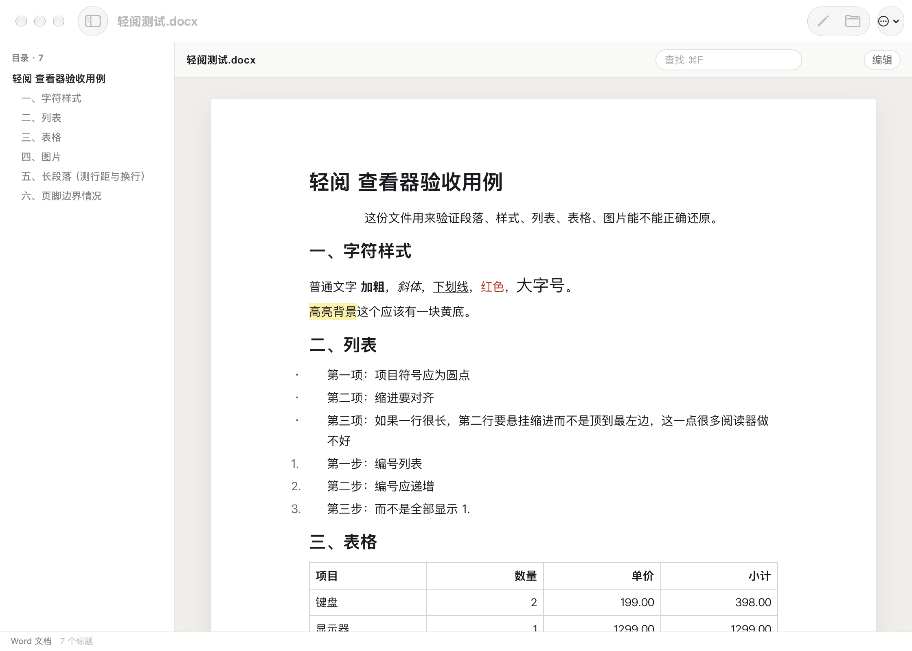

# 轻阅

一个只用来**看**的 macOS 小应用：docx / xlsx / pptx，以及老式的 doc / xls / ppt 和 WPS 的 wps / et / dps。不装 WPS、不装 Office、不装 LibreOffice —— 所有解析都是自己按规范手写的（OOXML 按 ECMA-376，老格式按 BIFF8 / MS-DOC / PPT 记录格式），应用本体 2.1 MB。

定位是查看器：打开就能正确显示，需要的时候也能改两个字、改一个数。



## 打开方式

- 双击文件（装好后 Finder 里会多一个「轻阅」，右键"打开方式"里也有）
- 拖文件到窗口里
- `⌘O` 选文件
- 命令行：`open -a 轻阅 xxx.docx`

## 能看什么

**Word（.docx）**
标题层级、粗体/斜体/下划线/删除线、字号、颜色、高亮底色、上下标、项目符号与多级编号（支持中文数字和罗马数字）、悬挂缩进、行距与段间距、合并单元格表格（含底纹和对齐）、内嵌图片、分页符。
左侧按标题生成目录，点一下跳到对应位置。

**Excel（.xlsx）**
表头冻结、行号列标、列宽、自动换行、单元格底纹与字体、内建数字格式（千分位、百分比、日期、负数括号、货币）、合并单元格、隐藏行列。
右上角可以按当前列升降序排序、在查找框里输入即过滤行（不是高亮，是真的只留下匹配行）。

**PowerPoint（.pptx）**
按原版式比例还原每页：文本框位置、字号字重、颜色、渐变与透明度、圆角、图片、表格、背景色。左侧列出每页标题，`⌘↑` / `⌘↓` 或底部按钮翻页。

## 老格式也能开（1.1.0 起）

`.doc` / `.xls` / `.ppt`（Office 97-2003 二进制）和 WPS 的 `.wps` / `.et` / `.dps` 现在都能直接打开。
这三种文件外面套的是同一个 OLE2 复合文档容器，所以先解容器（`CFB`），再按流名分发：

| 格式 | 认出来的依据 | 还原到什么程度 |
| --- | --- | --- |
| `.xls` / `.et` | 流 `Workbook` / `Book` | 单元格值、数字格式、日期、粗斜体、字号、颜色、底纹、对齐、列宽行高、合并单元格、冻结窗格；排序与筛选可用 |
| `.doc` / `.wps` | 流 `WordDocument` | 正文（含域结果、软回车、分页）、粗斜体/下划线/删除线、字号、颜色、高亮、段落对齐与缩进、段间距 |
| `.ppt` / `.dps` | 流 `PowerPoint Document` | 每页文字（标题与正文、项目符号），按页显示 |

**判断格式看字节，不看后缀**：很多"xls"其实是 xlsx、或者是 WPS 存的 OOXML，改过后缀的文件照样能打开。

老格式**只读**：二进制写回要重排整条记录流和 FAT 链，风险远大于收益，所以没做。

## 能改什么

只做最小编辑，不做排版：

- **Word**：双击段落改文字，回车提交，Esc 取消。原有格式保留。
- **Excel**：双击单元格改内容，回车提交，方向键换格。
- 改完 `⌘S` 存回原文件，或 `⌘⇧S` 另存。

写回是**最小改动**：只替换改动过的那一段/那一格，压缩包里其他部件（样式表、编号定义、图片、主题）一个字节都不动。用 Word / Excel / WPS 打开不会报错。

## 不做的事

明确不管，免得你找了半天：

- 公式不重算。xlsx 显示的是 Excel 上次保存时缓存的值；如果你在轻阅里改了一个被公式引用的格子，文件里的公式结果不会跟着变，等 Excel 打开时才重算。
- 不排版。改字只改文字内容，不会自动调整分页、行宽、字号。
- 段落里原本多种字体混排的，改完会统一成第一种格式。
- PowerPoint 只读，不能编辑。
- 老格式（doc/xls/ppt/wps/et/dps）一律只读。
- 老式 `.doc` 不还原表格结构、分栏、文本框绕排、图片；段落样式（比如"标题 1"）只取直接格式，不跟随样式表。
- 老式 `.ppt` 只取文字，不还原图形与版式（自选图形坐标在另一套 Escher 记录里，暂未解析）。
- PPT 的动画、切换效果、SmartArt、图表不渲染；自定义图形路径按外接矩形近似成圆或方。
- 加密（带密码）的文件打不开。

## 自己重新编译

```bash
cd ~/Documents/轻阅
./build.sh                        # 只出 arm64，快
ARCHS="arm64 x86_64" ./build.sh   # 通用二进制
```

产物是 `轻阅.app`。也可以只导出 HTML 看渲染对不对：

```bash
./build.sh
build/dump 某文件.docx /tmp/out.html      # xlsx 可以再加工作表序号
open /tmp/out.html
```

编译要求：装了 Xcode 最省事；只有 CommandLineTools 也能编 —— 脚本会自己挑一个合适的 SDK
（CLT 最新的 SDK 里 SwiftUI 的 `@State` 变成了宏，而宏插件只有 Xcode 才带，直接用会报一堆
`cannot find '$xxx' in scope`）。原因写在 `dev/开发笔记.md` 里。

图标是代码画的，不是图片素材：`./Tools/make-icon.sh` 重新生成 `Resources/AppIcon.icns`。

## 目录

```
Sources/Core/     ZIP、XML、三种格式的解析与渲染（CLI 和 App 共用）
Sources/UI/       SwiftUI 窗口、侧边栏、WebPane
Tools/main.swift  命令行导出工具
Resources/        Info.plist、图标
dev/开发笔记.md    踩过的坑
```
